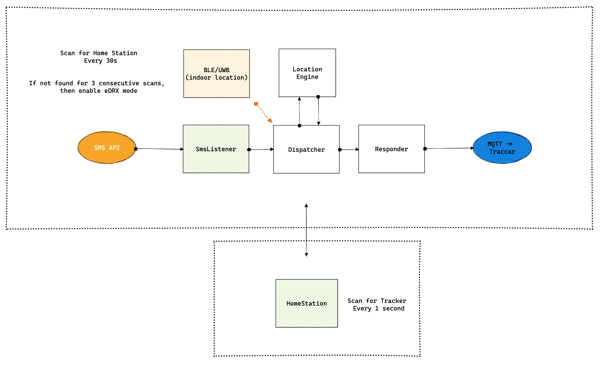

# FindMyCat - Outdoor Location Engine

Hardware: FindMyCat V3 Custom Board.

Software Architecture:

## MQTT Data format
When sending data over mqtt the following format is used to send a comma separated string to save as much data as possible.

latitude,longitude,satellites_tracked,accuracy
